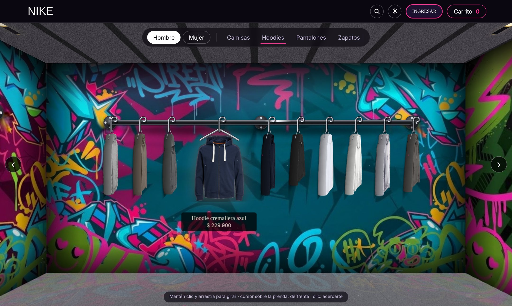

# Armario



Tienda de ropa urbana construida como una pieza de motion design. En lugar de un catálogo en cuadrícula, el cliente entra a un estudio de grafiti en 3D: cuatro paredes pintadas, un techo con tubos de neón y un piso de concreto con salpicaduras de spray. En cada pared cuelga una colección (camisas, hoodies, pantalones y zapatos). Se gira el cuarto arrastrando, las prendas se balancean con la inercia del giro y al tocar una la cámara se acerca hasta abrir su ficha. Detrás de esa capa visual hay una tienda completa: inventario por talla en MySQL, carrito, pago de demostración, facturas, cuentas de usuario, seguimiento de pedidos, PQRS y un panel de administración.

La app se puede usar en el navegador del computador, instalarse en el celular como PWA o abrirse con la APK para Android incluida en el proyecto.

---

## Contenido

1. [Recorrido por la app](#recorrido-por-la-app)
2. [Motion design](#motion-design)
3. [Funciones de la tienda](#funciones-de-la-tienda)
4. [Tecnologías y librerías](#tecnologías-y-librerías)
5. [Requisitos](#requisitos)
6. [Instalación y puesta en marcha](#instalación-y-puesta-en-marcha)
7. [Uso en el celular: PWA y APK](#uso-en-el-celular-pwa-y-apk)
8. [Configuración](#configuración)
9. [Estructura del proyecto](#estructura-del-proyecto)
10. [Base de datos](#base-de-datos)
11. [API](#api)
12. [Panel de administración](#panel-de-administración)
13. [Scripts disponibles](#scripts-disponibles)
14. [Datos de prueba](#datos-de-prueba)
15. [Solución de problemas](#solución-de-problemas)
16. [Limitaciones conocidas](#limitaciones-conocidas)
17. [Créditos y licencia](#créditos-y-licencia)

La documentación técnica completa está en [`docs/DOCUMENTACION.md`](docs/DOCUMENTACION.md) y en PDF en `docs/Documentacion-Armario.pdf`.

---

## Recorrido por la app

1. **Portada.** La marca entra con el espaciado de letras cerrándose y un desfase de color cian y rosa que falla cada pocos segundos, como un fotograma mal impreso. Se baja arrastrando o con la rueda del ratón.
2. **Elección de colección.** Dos tarjetas, Hombre y Mujer, con un acercamiento lento de la foto. Al elegir una, tres trazos de spray barren la pantalla con el nombre de la sección.
3. **El cuarto.** La cámara entra girando desde atrás. Cada pared tiene su colección colgada de un tubo de hierro con bridas. Se gira con arrastre, flechas del teclado, botones o pestañas.
4. **La prenda.** Al pasar el cursor, la prenda gira de perfil a frente y muestra nombre y precio. Al hacer clic, la cámara se acerca con líneas de velocidad estilo cómic y la prenda vuela hasta la ficha.
5. **La ficha.** Color, tallas con su stock real, cantidad, lupa al pasar el cursor y un sticker con la talla elegida.
6. **Compra.** Carrito lateral, datos de envío, pago con tarjeta (simulado) o contra entrega, aceptación de términos y factura lista para imprimir o guardar en PDF.
7. **Cuenta.** Perfil, pedidos con su línea de tiempo, cambio de contraseña y solicitudes de PQRS.

En el celular el cuarto se mantiene y debajo aparece una pasarela horizontal con las prendas de la pared actual, más fácil de tocar.

---

## Motion design

El movimiento es la base de la interfaz, no un adorno. Cada animación responde a una regla física o comunica un cambio de estado.

| Elemento | Cómo se mueve | Dónde está |
|---|---|---|
| Cuarto 3D | Caja de cuatro paredes, techo y piso con transformaciones CSS 3D. La cámara está detrás del centro para que se vean las esquinas | `client/src/room.jsx` |
| Giro | Arrastre horizontal con inercia. Al soltar, un resorte (rigidez 75, amortiguación 17) acomoda la pared más cercana | `Room` |
| Prendas | Cada una es un péndulo con su propio resorte. La velocidad de giro del cuarto las empuja y al llegar a una pared reciben un golpe escalonado de 65 ms entre una y otra | `Slot` |
| Volumen de la ropa | La silueta de cada foto se repite en 8 capas a distinta profundidad, con el color promedio de la prenda y sombra hacia atrás. De lado se ve el grosor | `LAYERS`, `DEPTH` |
| Ganchos | Gancho cromado dibujado en SVG que siempre mira a la cámara; la percha gira con la prenda | `Hook`, `Hanger` |
| Zapatos | Pirámide de vitrinas de vidrio. Cada zapato flota, da un salto al llegar a la pared y un brillo cruza el vidrio | `Pyramid`, `Block` |
| Cámara | Entrada al cuarto en 1,7 s; acercamiento a la prenda en 0,62 s con curva `[.7, 0, .2, 1]` | `pick` |
| Transición prenda a ficha | La misma prenda viaja de la pared a la ficha (`layoutId` de Framer Motion) | `App.jsx` |
| Cambio de pantalla | Tres trazos de spray con borde de pincel generado como máscara SVG y un cuarto trazo negro con el nombre de la sección | `client/src/fx.jsx` |
| Ambiente | Neón que se enciende con parpadeo y titila, rieles de luz que respiran, barrido de luz en las paredes, destello que recorre el tubo, polvo flotando, reflejo del piso | `styles.css` (sección v5) |
| Interfaz | Botones con brillo y rebote, filas del carrito en cascada, línea de tiempo del pedido, borde de neón giratorio en el ingreso | `styles.css` |

**Rendimiento.** Las animaciones de ambiente usan solo `transform` y `opacity`, que el navegador resuelve en la GPU sin volver a pintar. Al entrar al cuarto se mide la fluidez durante 1,5 segundos; si el equipo no llega a 40 cuadros por segundo, la app activa un modo liviano que apaga el volumen de las prendas y los efectos más costosos. En la APK las animaciones se pausan cuando la app pasa a segundo plano.

**Accesibilidad.** Si el sistema tiene activada la opción de reducir movimiento, se apagan las animaciones decorativas y la cámara cambia sin transición.

---

## Funciones de la tienda

- Catálogo de 80 productos (10 por categoría y género) con fotos recortadas.
- Inventario por producto, color y talla. Empieza en 1000 unidades por combinación y nunca baja de cero, ni siquiera con compras simultáneas.
- Tallas agotadas tachadas y aviso de últimas unidades.
- Buscador por nombre, categoría, color o género.
- Carrito persistente en el navegador, envío con valor mínimo para envío gratis y barra de progreso.
- Pago con tarjeta crédito o débito (simulado, valida número con algoritmo de Luhn, fecha y CVV) o contra entrega.
- Factura con datos del vendedor, subtotal, envío, base gravable e IVA del 19 %.
- Registro con validación de celular por país, correo, contraseña fuerte, dirección y ciudad.
- Inicio de sesión por nombre o correo, con bloqueo temporal tras 8 intentos fallidos.
- Cuenta con foto de perfil, pedidos, seguimiento por estados, cancelación mientras el pedido no haya salido, cambio de contraseña y solicitudes.
- PQRS con número de radicado, fecha y hora, también para invitados.
- Páginas de términos, tratamiento de datos, cambios y devoluciones, y envíos.
- Panel de administración con indicadores, pedidos, inventario editable y respuesta a PQRS.
- Tema claro y oscuro.
- PWA instalable con funcionamiento sin conexión del catálogo ya visitado.
- APK para Android de 124 KB.

---

## Tecnologías y librerías

| Capa | Herramienta | Versión | Uso |
|---|---|---|---|
| Interfaz | React | 18.3.1 | Componentes y estado de la tienda |
| Interfaz | React DOM | 18.3.1 | Render en el navegador |
| Animación | Framer Motion | 11.18 | Resortes, valores de movimiento, transiciones compartidas (`layoutId`), presencia de elementos |
| Empaquetado | Vite | 5.4 | Servidor de desarrollo y compilación de producción |
| Empaquetado | @vitejs/plugin-react | 4.7 | Soporte de JSX y recarga rápida |
| Servidor | Node.js (módulo `http`) | 18 o superior | API REST y archivos estáticos, sin frameworks |
| Base de datos | MySQL / MariaDB (XAMPP) | MariaDB 10.4 o superior, MySQL 8 | Productos, inventario, usuarios, pedidos, PQRS |
| Conector | mysql2 | 3.x | Pool de conexiones, consultas preparadas y transacciones |
| Seguridad | `crypto` de Node | incluido | Contraseñas con scrypt y sal, tokens aleatorios, hash SHA-256 de sesiones |
| PWA | Web App Manifest y Service Worker | estándar web | Instalación y modo sin conexión |
| Android | WebView del sistema | Android 7.0 o superior | Contenedor de la APK |
| Android (compilación) | aapt2, smali, Python | ver `android/` | Armado de la APK sin Gradle |
| Tipografías | Anton y Manrope (Google Fonts) | | Títulos y texto |
| Imágenes | Python, OpenCV, Pillow | opcional | Limpieza de paredes y recorte de ganchos (`tools/`) |

No se usan librerías de estilos ni de componentes. Todo el CSS está escrito a mano en `client/src/styles.css`, con variables para el tema claro y oscuro.

---

## Requisitos

Para usar la tienda en un computador:

| Programa | Para qué | Descarga |
|---|---|---|
| Node.js 18 o superior (recomendado 20 LTS), con npm | Ejecutar el servidor y compilar la interfaz | https://nodejs.org |
| XAMPP 8.x (o cualquier MySQL 8 / MariaDB 10.4 o superior) | Base de datos. De XAMPP solo se usa MySQL | https://www.apachefriends.org |
| Un navegador actual (Chrome, Edge, Firefox o Safari) | Abrir la tienda | |

Opcional:

| Programa | Para qué |
|---|---|
| Un celular Android 7.0 o superior | Instalar la APK |
| Python 3 con `opencv-contrib-python` y `pillow` | Volver a procesar las fotos de paredes y prendas |
| Java 11 o superior y Python 3 con `repro-apk` y `cryptography` | Volver a compilar la APK |

---

## Instalación y puesta en marcha

1. Descomprime el proyecto en una carpeta, por ejemplo `C:\proyectos\armario`.
2. Abre el **XAMPP Control Panel** y pulsa **Start** en **MySQL**. Apache solo hace falta si quieres ver la base en phpMyAdmin.
3. Abre una terminal en la carpeta del proyecto e instala todo y compila la interfaz (solo la primera vez):

   ```bash
   npm run setup
   ```

4. Arranca la tienda:

   ```bash
   npm start
   ```

5. Abre `http://localhost:3000`. El panel de administración está en `http://localhost:3000/admin`.

La primera vez el servidor crea la base `armario`, sus tablas y el inventario. No hace falta importar nada a mano. Si prefieres hacerlo desde phpMyAdmin, el archivo `database/armario.sql` trae la estructura y el catálogo.

Si existía `data/db.json` de una versión anterior, sus usuarios y pedidos pasan a MySQL al primer arranque y el archivo se renombra a `db.json.importado`.

**Modo desarrollo de la interfaz** (recarga al guardar):

```bash
npm start          # en una terminal: API en el puerto 3000
npm run dev        # en otra terminal: interfaz en http://localhost:5173
```

Después de cambiar algo en `client/src`, corre `npm run build` para que `npm start` sirva la versión nueva.

---

## Uso en el celular: PWA y APK

El servidor sigue corriendo en el computador. Al arrancar, la consola muestra la dirección para el celular:

```
Desde el celular (misma red WiFi): http://192.168.1.20:3000
```

El celular y el computador deben estar en la misma red WiFi. En Windows, la primera vez el firewall pregunta si permite que Node.js use la red: hay que aceptar para redes privadas.

### APK para Android

1. Copia `android/Armario.apk` al celular e instálala. Android pedirá permitir la instalación de apps de origen desconocido.
2. Al abrirla por primera vez, escribe la dirección que mostró la consola y pulsa **Conectar**.
3. La dirección queda guardada. Para cambiarla, usa **Cambiar servidor** en el pie de página o espera a que la app la pida si el servidor no responde.

La APK pesa 124 KB porque no lleva una copia de la tienda: abre el servidor dentro del WebView del sistema, igual que una PWA instalada. Por eso siempre muestra el inventario real. Dentro de la APK funcionan la impresión de facturas (servicio de impresión de Android, que permite guardar en PDF), la foto de perfil desde la galería y el botón atrás.

### PWA

La tienda incluye manifiesto e instalador (service worker). Se puede instalar desde Chrome con el botón **Instalar la app** de la portada o desde el menú del navegador, y en iPhone con Compartir y **Agregar a inicio**.

Los navegadores solo permiten instalar una PWA desde una dirección segura: `https://` o `http://localhost`. Desde una dirección de red local como `http://192.168.1.20:3000` la tienda funciona en el navegador del celular pero no se instala como app; para eso está la APK. Si la tienda se publica en un servidor con HTTPS, la PWA se instala en cualquier celular, Android o iPhone.

---

## Configuración

Todo está en `config.js` y se puede cambiar con variables de entorno, sin tocar el código.

| Variable | Valor por defecto | Descripción |
|---|---|---|
| `PORT` | `3000` | Puerto del servidor |
| `DB_HOST` | `127.0.0.1` | Servidor MySQL |
| `DB_PORT` | `3306` | Puerto de MySQL |
| `DB_USER` | `root` | Usuario de MySQL (el de XAMPP por defecto) |
| `DB_PASS` | vacío | Contraseña de MySQL |
| `DB_NAME` | `armario` | Nombre de la base |
| `ADMIN_TOKEN` | `admin123` | Clave del panel de administración. Cámbiala antes de publicar |
| `STOCK_INICIAL` | `1000` | Unidades iniciales por producto, color y talla |
| `ENVIO_COSTO` | `14900` | Costo del envío en pesos |
| `ENVIO_GRATIS_DESDE` | `250000` | Compra mínima para envío gratis |
| `ENVIO_DIAS` | `3 a 8 días hábiles` | Texto del tiempo de entrega |

Los datos del vendedor (razón social, NIT, dirección, teléfono, correo y horario) que aparecen en la factura y en las políticas están en el bloque `tienda` de `config.js`.

Ejemplo en Windows (PowerShell):

```powershell
$env:DB_PASS="miClave"; $env:ADMIN_TOKEN="otraClave"; npm start
```

En Linux o macOS:

```bash
DB_PASS=miClave ADMIN_TOKEN=otraClave npm start
```

---

## Estructura del proyecto

```
armario/
├── server.js              Servidor HTTP: API, archivos estáticos, caché
├── db.js                  Conexión a MySQL, creación de tablas, catálogo inicial, importación de db.json
├── config.js              Puerto, base de datos, envío, datos del vendedor
├── catalog.js             Productos, precios, colores y tallas del catálogo inicial
├── rules.json             Reglas de validación del registro
├── countries.json         Países, indicativos y longitud de celulares
├── database/armario.sql   Estructura y catálogo para importar en phpMyAdmin
├── public/admin.html      Panel de administración
├── imagenes/              Fotos de paredes, prendas y portadas (se sirven en /img)
├── tools/                 Scripts: exportar SQL, limpiar paredes, quitar ganchos de las fotos
├── docs/                  Documentación técnica (Markdown, PDF y capturas)
├── android/               Código y compilación de la APK
│   ├── Armario.apk        APK lista para instalar
│   ├── AndroidManifest.xml
│   ├── assets/setup.html  Pantalla para escribir la dirección del servidor
│   ├── java/              Código Java de referencia (para Android Studio)
│   ├── smali/             Código que se compila a classes.dex
│   ├── res/               Ícono, nombre y tema
│   ├── build.sh           Compilación sin Gradle
│   └── sign.py            Firma APK Signature Scheme v2
└── client/                Interfaz (React + Vite)
    ├── index.html
    ├── public/            Manifiesto, service worker, íconos
    ├── dist/              Versión compilada que sirve npm start
    └── src/
        ├── main.jsx       Arranque y registro del service worker
        ├── App.jsx        Pantallas, carrito, pago, factura, cuenta, ingreso
        ├── room.jsx       Cuarto 3D, cámara, prendas, ganchos, zapatos
        ├── art.jsx        Fotos de producto y dibujo de respaldo
        ├── fx.jsx         Transición de trazos de spray
        ├── pay.jsx        Formulario de pago y tarjeta animada
        ├── info.jsx       Políticas, PQRS y buscador
        ├── util.js        Moneda, envío, estados, fechas
        └── styles.css     Estilos y animaciones
```

---

## Base de datos

Base `armario` en MySQL o MariaDB, motor InnoDB, codificación `utf8mb4`.

| Tabla | Contenido |
|---|---|
| `productos` | Nombre, precio, género, categoría, orden y si está visible |
| `inventario` | Stock por producto, color y talla. Restricción `CHECK (stock >= 0)` |
| `usuarios` | Cuentas, contraseña con scrypt y sal, datos de envío, fecha de aceptación del tratamiento de datos |
| `sesiones` | Hash SHA-256 del token de sesión y su vencimiento (30 días) |
| `pedidos` | Código, número de factura, cliente, subtotal, envío, IVA, forma de pago, estado |
| `pedido_items` | Prendas de cada pedido con color, talla, cantidad y precio del momento |
| `pedido_historial` | Cada cambio de estado con fecha y nota |
| `pqrs` | Solicitudes con tipo, radicado, mensaje, estado y respuesta |

Una compra resta el stock con una sola sentencia condicionada (`UPDATE ... SET stock = stock - ? WHERE ... AND stock >= ?`) dentro de una transacción. Si alguna prenda no alcanza, se revierte todo el pedido. Cancelar un pedido devuelve las unidades.

---

## API

Todas las respuestas son JSON. Las rutas de cuenta usan `Authorization: Bearer <token>` y las de administración `Authorization: Bearer <ADMIN_TOKEN>`.

| Método | Ruta | Descripción |
|---|---|---|
| GET | `/api/catalog` | Productos visibles con colores, tallas e inventario |
| GET | `/api/rules` | Reglas de validación, países, datos de la tienda y envío |
| POST | `/api/register` | Crea una cuenta y devuelve sesión |
| POST | `/api/login` | Inicia sesión con nombre o correo |
| POST | `/api/logout` | Cierra la sesión actual |
| GET, PATCH | `/api/me` | Consulta o actualiza el perfil |
| POST | `/api/me/avatar` | Cambia la foto de perfil |
| POST | `/api/me/password` | Cambia la contraseña y cierra las demás sesiones |
| GET | `/api/me/orders` | Pedidos del usuario con historial |
| POST | `/api/me/orders/:codigo/cancel` | Cancela un pedido no enviado |
| GET | `/api/me/pqrs` | Solicitudes del usuario |
| POST | `/api/orders` | Crea un pedido (con o sin sesión) |
| POST | `/api/pqrs` | Crea una solicitud y devuelve el radicado |
| GET | `/api/admin/orders` | Pedidos, indicadores y tallas con menos stock |
| PATCH | `/api/admin/orders/:codigo` | Cambia el estado de un pedido |
| GET, PATCH | `/api/admin/inventory` | Consulta o ajusta el stock de una talla |
| PATCH | `/api/admin/products/:id` | Cambia precio, nombre o visibilidad |
| GET | `/api/admin/pqrs` | Lista de solicitudes |
| PATCH | `/api/admin/pqrs/:id` | Responde o cambia el estado de una solicitud |

El detalle de cada ruta, con cuerpos de petición y errores, está en la documentación.

---

## Panel de administración

`http://localhost:3000/admin`, con la clave de `ADMIN_TOKEN`.

- **Pedidos:** ventas, unidades en inventario, clientes y PQRS abiertas; lista de pedidos con cambio de estado (recibido, pagado, enviado, entregado, cancelado).
- **Inventario:** por género y categoría; precio, visibilidad y stock de cada talla. Los cambios se guardan al salir de la casilla. Las tallas con 20 unidades o menos se marcan en rojo.
- **PQRS:** respuesta y estado de cada solicitud. La respuesta aparece en la cuenta del cliente.

---

## Scripts disponibles

| Comando | Qué hace |
|---|---|
| `npm run setup` | Instala dependencias del servidor y de la interfaz y compila |
| `npm start` | Arranca el servidor en el puerto 3000 |
| `npm run build` | Compila la interfaz en `client/dist` |
| `npm run dev` | Interfaz en modo desarrollo (puerto 5173) |
| `npm run sql` | Regenera `database/armario.sql` desde `catalog.js` |
| `android/build.sh` | Vuelve a compilar la APK (ver `docs/DOCUMENTACION.md`) |

---

## Datos de prueba

| Dato | Valor |
|---|---|
| Usuario | `guesst` |
| Contraseña | `guesst123` |
| Clave del panel | `admin123` |
| Tarjeta | `4242 4242 4242 4242`, cualquier fecha futura, CVV `123` |

Los pagos son una demostración: no se cobra nada. El número completo de la tarjeta y el CVV nunca salen del navegador; el servidor solo guarda la franquicia y los últimos cuatro dígitos.

---

## Solución de problemas

| Síntoma | Causa probable | Solución |
|---|---|---|
| `No pude conectar con MySQL en 127.0.0.1:3306` | MySQL apagado | Pulsa Start en MySQL en XAMPP |
| `Access denied for user 'root'` | MySQL tiene contraseña | Usa `DB_PASS` o edita `config.js` |
| MySQL no arranca en XAMPP | El puerto 3306 está ocupado por otro MySQL | Cierra el otro servicio o cambia el puerto en XAMPP y en `DB_PORT` |
| La página dice que no pudo cargar el catálogo | El servidor no está corriendo | `npm start` |
| Los cambios en `client/src` no aparecen | Falta compilar | `npm run build` |
| El celular no abre la tienda | Redes distintas o firewall | Misma red WiFi y permitir Node.js en el firewall de Windows |
| No aparece el botón para instalar la PWA | Dirección sin HTTPS | Usa la APK o publica con HTTPS |
| La APK no se instala | Instalación de origen desconocido bloqueada | Permitirla en Ajustes para el explorador de archivos |
| Las animaciones van lentas | Equipo sin aceleración gráfica | La app activa sola el modo liviano. También se puede forzar con `?calidad=baja` en la dirección o activar reducir movimiento en el sistema |
| La ropa se ve plana aunque el equipo es rápido | La medición automática eligió el modo liviano | Abrir la tienda con `?calidad=alta` (se recuerda; `?calidad=auto` vuelve a medir) |

---

## Limitaciones conocidas

- Los pagos son simulados. Para cobrar de verdad hay que integrar una pasarela como Wompi, PayU o Mercado Pago.
- La factura no es una factura electrónica válida ante la DIAN.
- No se envían correos (confirmación de compra, recuperación de contraseña).
- Las políticas legales son textos de ejemplo y deben revisarse antes de publicar.
- La PWA solo se instala desde una dirección con HTTPS o desde `localhost`.

---

## Créditos y licencia

Proyecto académico. Las fotografías de producto, los nombres comerciales y los logotipos pertenecen a sus respectivos dueños y se usan solo con fines de demostración. Las tipografías Anton y Manrope se distribuyen bajo la licencia SIL Open Font License. El código del proyecto puede usarse y modificarse con fines educativos.
