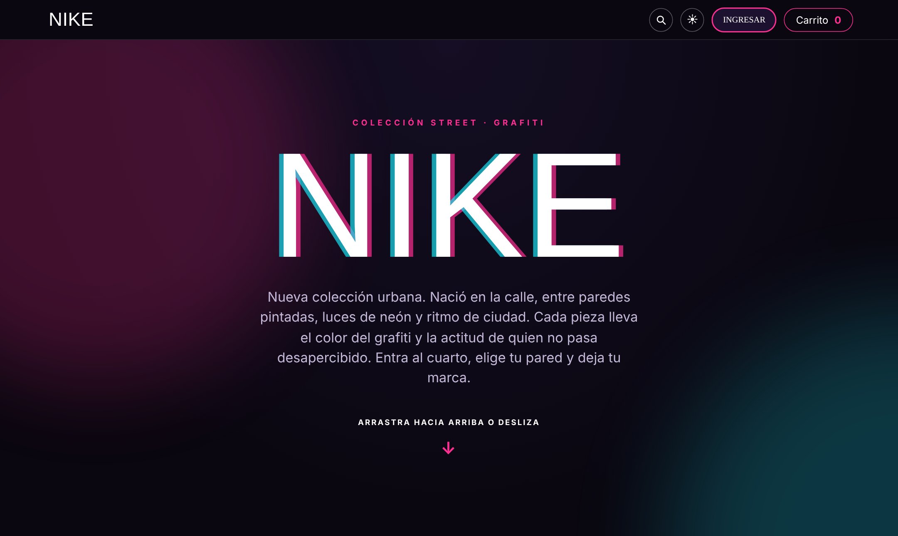
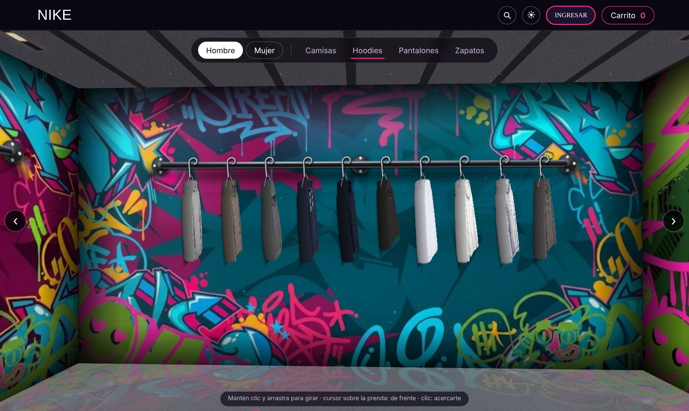
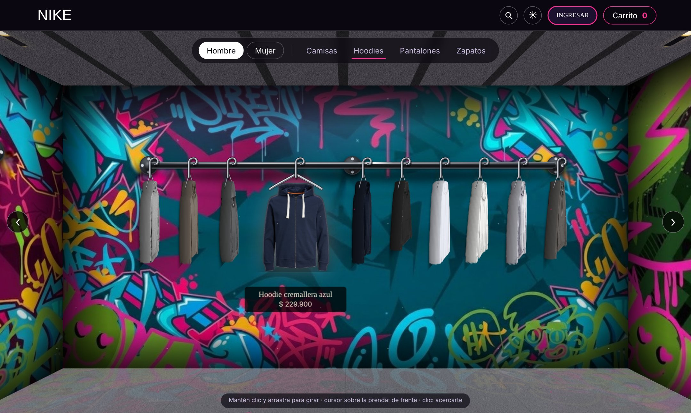
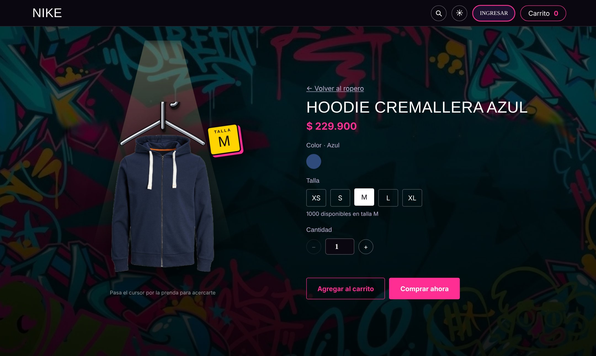
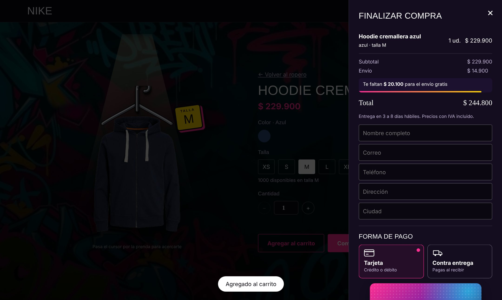
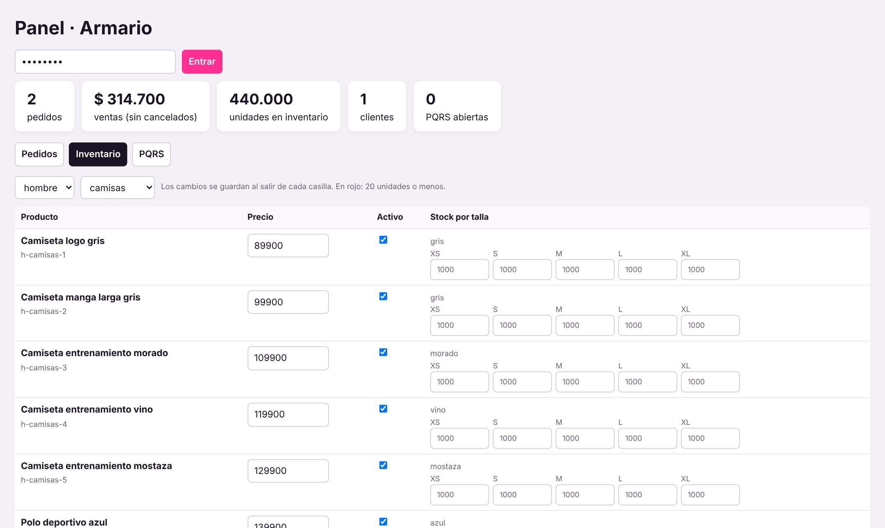
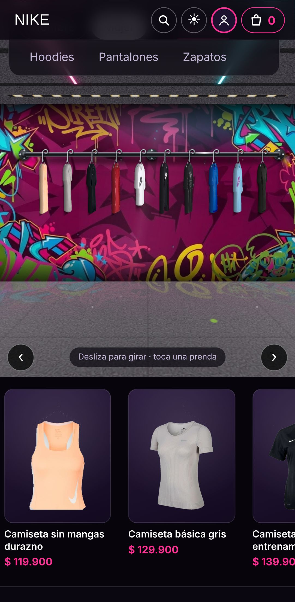

# Armario: documentación técnica

Versión 7 · noviembre de 2026

## 1. Introducción

### 1.1 Propósito

Este documento describe el diseño, el funcionamiento y el mantenimiento de Armario, una tienda virtual de ropa urbana cuya interfaz principal es un cuarto en 3D animado. Está pensado para quien tenga que instalar el proyecto, modificarlo, presentarlo o continuarlo.

### 1.2 Alcance

Armario cubre el ciclo completo de una compra en línea: exploración del catálogo, selección de color y talla, carrito, datos de envío, pago de demostración, factura, seguimiento del pedido y atención de solicitudes. También incluye un panel para administrar pedidos, inventario y solicitudes, una versión instalable como PWA y una APK para Android.

Quedan por fuera el cobro real con una pasarela de pagos, la facturación electrónica ante la DIAN, el envío de correos y la integración con transportadoras. La sección 15 explica qué haría falta para cada uno.

### 1.3 Idea de diseño

La mayoría de tiendas en línea presentan los productos en una cuadrícula. Armario parte de otra pregunta: cómo se sentiría entrar a una tienda física pequeña, pintada de grafiti, donde la ropa cuelga de un tubo en la pared. La respuesta llevó a tratar la interfaz como una pieza de motion design: la cámara, la gravedad de las prendas y las transiciones son las que guían la navegación. La estética mezcla la limpieza de las campañas deportivas con el grafiti y el color de animaciones como Arcane y Spider-Man: Into the Spider-Verse (rosa neón, cian y amarillo sobre fondos casi negros, desfases de color y trazos de spray).

### 1.4 Términos usados

| Término | Significado en este documento |
|---|---|
| Pared | Cada una de las cuatro caras del cuarto. Contiene una categoría |
| Slot | Espacio de una prenda en el tubo |
| Ficha | Pantalla de detalle de un producto |
| Wipe | Transición de pantalla con trazos de spray |
| PWA | Aplicación web progresiva: sitio que se instala y funciona como app |
| APK | Paquete de instalación de Android |
| Radicado | Número único que identifica una solicitud de PQRS |
| PQRS | Peticiones, quejas, reclamos y sugerencias |

## 2. Descripción general

### 2.1 Usuarios

| Usuario | Qué puede hacer |
|---|---|
| Visitante | Recorrer el cuarto, buscar, ver fichas, agregar al carrito, comprar como invitado y abrir una solicitud de PQRS |
| Cliente registrado | Lo anterior, más guardar sus datos de envío, ver sus pedidos y su historial, cancelar pedidos no enviados, cambiar su contraseña y su foto, y consultar las respuestas a sus solicitudes |
| Administrador | Ver indicadores, cambiar estados de pedidos, ajustar stock por talla, cambiar precios, ocultar productos y responder solicitudes |

### 2.2 Recorrido principal

1. Portada con la marca y la elección entre Hombre y Mujer.
2. Transición de spray y entrada de la cámara al cuarto.
3. Giro entre paredes: camisas, hoodies, pantalones y zapatos.
4. Clic en una prenda: acercamiento de cámara y apertura de la ficha.
5. Elección de color, talla y cantidad; se agrega al carrito o se compra directamente.
6. Datos de envío, forma de pago y aceptación de términos.
7. Confirmación con factura imprimible.
8. Seguimiento desde la cuenta.

### 2.3 Capturas















### 2.4 Requisitos funcionales cubiertos

| Código | Requisito | Dónde se resuelve |
|---|---|---|
| RF-01 | Mostrar el catálogo por género y categoría | `GET /api/catalog`, `Room` |
| RF-02 | Mostrar disponibilidad por talla | `inventario`, `Detail` |
| RF-03 | Buscar productos | `Search` en `info.jsx` |
| RF-04 | Agregar, quitar y modificar prendas del carrito | `Panel` en `App.jsx`, `localStorage` |
| RF-05 | Calcular envío y total con IVA | `shipOf` en `util.js`, `createOrder` en `server.js` |
| RF-06 | Pagar con tarjeta o contra entrega | `pay.jsx`, `createOrder` |
| RF-07 | Generar factura numerada | `pedidos.factura` |
| RF-08 | Registrar usuarios con datos validados | `POST /api/register`, `rules.json`, `countries.json` |
| RF-09 | Iniciar y cerrar sesión | `POST /api/login`, `POST /api/logout` |
| RF-10 | Consultar y cancelar pedidos | `GET /api/me/orders`, `POST /api/me/orders/:codigo/cancel` |
| RF-11 | Registrar y responder PQRS | `pqrs`, `POST /api/pqrs`, panel |
| RF-12 | Administrar inventario y precios | `/api/admin/inventory`, `/api/admin/products/:id` |
| RF-13 | Instalar la tienda en el celular | Manifiesto, service worker, APK |

### 2.5 Requisitos no funcionales

| Código | Requisito | Cómo se cumple |
|---|---|---|
| RNF-01 | El stock nunca debe quedar negativo | Resta condicionada dentro de una transacción y restricción `CHECK` |
| RNF-02 | Las contraseñas no se guardan en texto plano | scrypt con sal aleatoria de 8 bytes |
| RNF-03 | Los datos de la tarjeta no salen del navegador | Solo viajan franquicia y últimos cuatro dígitos |
| RNF-04 | La interfaz debe ser fluida en equipos modestos | Animaciones en GPU y modo liviano automático |
| RNF-05 | Debe respetar la preferencia de reducir movimiento | `prefers-reduced-motion` y `useReducedMotion` |
| RNF-06 | Debe funcionar en celular | Diseño adaptable, pasarela de prendas, PWA y APK |
| RNF-07 | Instalación sencilla con XAMPP | La base y las tablas se crean solas |

## 3. Arquitectura

### 3.1 Vista general

```
 Navegador / PWA / APK (WebView)
        |
        |  HTTP: páginas, fotos y JSON
        v
 Servidor Node.js (server.js) ---- archivos estáticos: client/dist, imagenes, admin.html
        |
        |  mysql2 (pool de 10 conexiones, consultas preparadas)
        v
 MySQL / MariaDB de XAMPP: base "armario"
```

El servidor no usa frameworks: se apoya en el módulo `http` de Node. Esto mantiene el proyecto pequeño y deja ver con claridad cómo se atiende cada petición. La interfaz es una aplicación de una sola página hecha con React y compilada con Vite; el servidor entrega `client/dist/index.html` para cualquier ruta sin extensión.

### 3.2 Flujo de una compra

1. El navegador envía `POST /api/orders` con los datos del cliente, la forma de pago, la aceptación de términos y las prendas (producto, color, talla, cantidad).
2. El servidor valida los datos y agrupa líneas repetidas.
3. Abre una transacción. Por cada línea ejecuta `UPDATE inventario SET stock = stock - cantidad WHERE ... AND stock >= cantidad`. Si alguna no afecta filas, consulta el stock real, revierte la transacción y responde con un mensaje como "talla M: solo quedan 3".
4. Calcula subtotal, envío, base gravable e IVA, inserta el pedido, sus prendas y el primer estado del historial, y asigna el número de factura a partir del identificador (`NK-000123`).
5. Confirma la transacción y devuelve el pedido completo, que la interfaz muestra como factura.

Con esta forma de restar el stock, dos compras simultáneas de la última unidad no pueden tener éxito las dos: la base procesa las sentencias una tras otra y la segunda ya no cumple la condición. Se probó con diez compras en paralelo sobre cinco unidades: cinco fueron aceptadas, cinco rechazadas y el stock quedó en cero.

## 4. Interfaz (client)

### 4.1 Módulos

| Archivo | Responsabilidad |
|---|---|
| `main.jsx` | Monta la app y registra el service worker cuando la página está en HTTPS o en localhost |
| `App.jsx` | Estado global, cabecera, portada, ficha, carrito y pago, factura, cuenta, ingreso y registro, pie de página, capas de información |
| `room.jsx` | Cuarto 3D: tamaños, cámara, giro, paredes, tubo, prendas con péndulo y volumen, ganchos, pirámide de zapatos, calidad automática |
| `art.jsx` | Carga de la foto de cada producto con respaldo dibujado en SVG, colores y cálculo del color promedio de una foto |
| `fx.jsx` | Transición de spray entre pantallas |
| `pay.jsx` | Formulario de pago, validación de tarjeta y tarjeta animada que se voltea al escribir el CVV |
| `info.jsx` | Textos de políticas, formulario de PQRS y buscador |
| `util.js` | Formato de moneda, envío, nombres de estados, fechas |
| `styles.css` | Estilos, temas claro y oscuro, animaciones, adaptación a celular |

### 4.2 Estado de la aplicación

El componente `App` guarda el estado principal con `useState`:

| Estado | Contenido |
|---|---|
| `data` | Catálogo recibido de la API |
| `g`, `c`, `turn` | Género, categoría (pared) y número de cuartos de vuelta acumulados |
| `sel` | Índice de la prenda abierta en la ficha |
| `cart` | Carrito, sincronizado con `localStorage` |
| `panel` | Panel lateral abierto: carrito, compra directa o cuenta |
| `doc` | Capa de política o PQRS, que se abre encima de cualquier panel para no perder lo que el usuario estaba escribiendo |
| `token`, `user` | Sesión, guardada en `localStorage` |
| `theme` | Tema claro u oscuro |

No hay enrutador: la navegación se resuelve con este estado y con la transición de spray, que cambia la pantalla en el instante en que el trazo negro la cubre por completo.

Datos guardados en el navegador: `cart` (carrito), `tk` (token de sesión) y `theme` (tema). El token se envía en la cabecera `Authorization`.

### 4.3 Atajos de inicio

La dirección `/?g=hombre` o `/?g=mujer` abre directamente el cuarto de esa colección. El manifiesto de la PWA usa estos atajos para el menú que aparece al mantener presionado el ícono.

### 4.4 Adaptación a celular

Por debajo de 700 px de ancho:

- La cabecera se compacta: búsqueda, tema, cuenta y carrito pasan a ser íconos.
- La pared mide 1,2 veces el ancho de la pantalla. No se agrandó más porque Chrome para Android dejaba de pintar el techo y el piso durante el giro.
- Aparecen flechas de giro abajo y la pista "Desliza para girar · toca una prenda".
- Debajo del cuarto se muestra una pasarela horizontal con las prendas de la pared actual, con desplazamiento por imán (`scroll-snap`). Cada tarjeta abre la ficha.
- Los paneles laterales ocupan todo el ancho.
- Se respetan las zonas seguras de pantallas con muesca (`env(safe-area-inset-*)`).

## 5. Motion design

### 5.1 Principios

1. **El movimiento explica.** La cámara se acerca a la prenda que se eligió; la prenda viaja a la ficha; el trazo de spray tapa la pantalla mientras cambia. El usuario siempre sabe de dónde viene y a dónde va.
2. **Física antes que tiempos fijos.** Giros, péndulos y botones usan resortes con rigidez y amortiguación. Así las animaciones se interrumpen y retoman sin saltos.
3. **Cada prenda es distinta.** Los resortes cambian un poco según la posición de la prenda; si todas se movieran igual, el tubo parecería una sola pieza.
4. **El ambiente no compite.** Neón, polvo y destellos son lentos, de baja opacidad y con pausas largas.
5. **Nunca a costa de la fluidez.** Lo que no se puede animar en la GPU se simplifica o se apaga.

### 5.2 El cuarto

El cuarto es una caja armada con transformaciones CSS 3D. Sus medidas salen del tamaño de la ventana:

| Medida | Fórmula | Uso |
|---|---|---|
| `W` | `min(alto × 1,48; ancho × 0,94)` en computador, `ancho × 1,2` en celular | Ancho de cada pared |
| `R` | `W / 2` | Alto de la pared y radio de la caja |
| `D` | `R × 1,3` | Distancia de perspectiva |
| `T` | `(alto − R) × 0,55` | Margen superior: deja ver techo y piso |

Las cuatro paredes giran alrededor de un eje vertical que pasa por el centro de la caja (`transform-origin` con profundidad `R`). Cada pared recibe su propio ángulo (`giro`, `giro − 90°`, `giro − 180°`, `giro − 270°`) en lugar de heredar el del contenedor. Esto parece redundante, pero resolvió un problema real: con el giro heredado, el navegador solo detectaba el cursor en la primera pared.

Techo y piso giran con un contenedor aparte. El techo tiene vigas, dos tubos de neón y dos rieles de luces; el piso es concreto con juntas, salpicaduras de spray y el reflejo de las cuatro paredes, invertido y desvanecido con una máscara.

### 5.3 Giro por arrastre

- Se ignoran los movimientos menores de 7 px para no confundir un clic con un arrastre.
- Arrastrar el 80 % del ancho visible equivale a 90 grados.
- La velocidad se suaviza con un promedio móvil (65 % del valor anterior, 35 % del nuevo) y se limita a 500 grados por segundo.
- Al soltar, se proyecta la posición final con la velocidad (`ángulo + velocidad × 0,2`), se redondea a la pared más cercana sin pasar de dos paredes de distancia, y un resorte (rigidez 75, amortiguación 17) termina el movimiento partiendo de la velocidad que traía la mano.
- Si el último movimiento fue hace más de 90 ms, se considera que el usuario se detuvo y no se aplica inercia.

Con flechas, botones o pestañas el giro dura 1,1 s con la curva `[.65, 0, .25, 1]`, que arranca despacio, acelera y frena suave.

### 5.4 Prendas en péndulo

Cada prenda tiene un péndulo propio que se calcula en cada cuadro con `useAnimationFrame`:

```
objetivo  = limitar(−velocidadDelCuarto × 0,045; −11°; 11°)
velocidad = velocidad + (−K × (ángulo − objetivo) − C × velocidad) × dt
ángulo    = limitar(ángulo + velocidad × dt; −28°; 28°)
```

`K` (rigidez) vale 46, 60 o 74 y `C` (amortiguación) 2,6 o 3,3 según la posición de la prenda. Mientras el cuarto gira, las prendas se inclinan hacia atrás; cuando frena, siguen oscilando hasta detenerse. Al llegar a una pared, cada prenda recibe un impulso de entre 34 y 54 grados por segundo, una tras otra con 65 ms de diferencia, como si el tubo se hubiera sacudido. Cuando el péndulo está quieto, el cálculo se salta para no gastar recursos.

Además del péndulo, cada prenda tiene un vaivén muy lento (±1,4° en 5 a 9 segundos) que la mantiene viva aunque no se toque nada.

### 5.5 Perfil y frente

En reposo las prendas están giradas 80 grados, de perfil, como en un perchero real. Al pasar el cursor giran a 0 grados, crecen al 112 % y su espacio en el tubo se ensancha de 9,5 a 17 unidades para no tapar a las vecinas. Todo con resortes (rigidez 120 a 170).

### 5.6 Volumen de la ropa

Una foto plana vista de perfil se reduce a una línea. Para que la prenda tenga grosor, se apilan capas de su silueta a distinta profundidad:

- 8 capas intermedias entre +0,42 y −0,42 del grosor, más la foto de frente (+0,5) y una espalda oscurecida (−0,5).
- Grosor según el tipo: camisas 1,05, pantalones 1,2 y hoodies 1,8 unidades de contenedor (cqw).
- Las capas intermedias no son copias de la foto: son la silueta (máscara CSS con la misma imagen) rellena con el color promedio de la prenda, calculado una vez por foto en un `canvas`. Las primeras pruebas con copias de la foto mostraban rayas verticales en el costado; con la silueta de un solo color el costado se ve continuo.
- Las capas centrales son un 2,5 % más grandes, lo que redondea el costado, y se oscurecen hacia atrás (brillo de 0,88 en la capa más cercana al frente, 0,58 en la más lejana y 0,42 en la espalda).
- Se recorta la franja superior de cada capa para que el gancho no tenga grosor.
- El volumen solo se dibuja en la pared de enfrente y en la que se va mientras termina de girar.

El contenedor de la prenda no puede llevar filtros (como sombras) porque el navegador aplanaría las capas; la sombra se aplica a la capa trasera.

### 5.7 Ganchos

Las fotos originales traían un gancho blanco muy delgado que desaparecía cuando la prenda estaba de perfil. Se borró de las fotos con `tools/strip_hangers.py` y la app dibuja su propio gancho en SVG con trazo cromado, borde oscuro y una sombra desplazada (más barata que un filtro). El gancho va fuera de la prenda, siempre de frente a la cámara, y sube por delante del tubo. La percha, en cambio, sí gira con la prenda. Los pantalones llevan una barra con dos pinzas.

### 5.8 Cámara

- **Entrada al cuarto:** parte 0,42 W hacia atrás y girada −24 grados, y llega al centro en 1,7 s.
- **Acercamiento a una prenda:** mide la posición de la prenda en pantalla, desplaza la cámara para centrarla y avanza hasta ampliarla 2,2 veces (1,8 en celular) en 0,62 s. Al mismo tiempo aparecen líneas de velocidad de cómic, hechas con un degradado cónico repetido y una máscara radial.
- **Regreso:** la cámara se aleja de la prenda que se estaba viendo y, al llegar, la pared recibe el sacudón de llegada.

### 5.9 De la pared a la ficha

La prenda del tubo y la imagen grande de la ficha comparten el mismo `layoutId` de Framer Motion. Al abrir la ficha, la librería anima la diferencia de posición y tamaño entre ambas, y la prenda vuela de la pared a su lugar. El fondo de la ficha es la misma pared desenfocada y ampliada, que se enfoca en 0,9 s.

En la ficha:

- **Lupa:** al mover el cursor sobre la prenda, la imagen se amplía 1,75 veces tomando como origen el punto del cursor.
- **Punch-in:** al elegir talla, la imagen salta al 130 % y vuelve al 106 % con un resorte rígido, aparece un anillo de puntos y cae un sticker amarillo con la talla, girado y con sombra dura.

### 5.10 Transición de spray

Cuatro trazos (rosa, cian, amarillo y negro) cruzan la pantalla inclinados 13 grados. El borde de cada trazo es una máscara SVG con forma de pincel, generada una sola vez con un generador pseudoaleatorio con semilla, así siempre tienen la misma forma y no cuestan nada en cada uso. Cuando el trazo negro cubre la pantalla se cambia el contenido y aparece el nombre de la sección con un resorte; después los trazos salen en orden inverso.

### 5.11 Ambiente

| Efecto | Detalle |
|---|---|
| Neón del techo | Se enciende con parpadeo escalonado en 1,4 s y titila brevemente cada 9 s |
| Rieles de luz | Opacidad que respira entre 0,7 y 1 cada 3,2 s |
| Paredes | Barrido de luz diagonal cada 11 s, desfasado por pared; resplandor rosa y cian que late |
| Tubo | Destello que lo recorre cada 7 s |
| Polvo | Partículas rosas, cian y blancas que suben lentamente |
| Piso | El reflejo de las paredes cambia de intensidad |
| Zapatos | Flotan dentro de su vitrina y un brillo cruza el vidrio |
| Flechas | Pequeño empujón lateral cada 3 s que invita a usarlas |

Todas usan `transform` u `opacity`. Las primeras versiones animaban `left`, `filter` y `box-shadow`; al medirlas, obligaban a repintar paredes enteras en cada cuadro y se reemplazaron.

### 5.12 Calidad automática

2,6 segundos después de entrar al cuarto (cuando ya terminó la entrada de cámara) se cuentan los cuadros durante 1,5 segundos. Si hay una pausa de más de 300 ms (pestaña oculta, por ejemplo) la medición vuelve a empezar. Si el promedio queda por debajo de 40 cuadros por segundo, el cuarto pasa a modo liviano (`.room.lite`): sin volumen en las prendas, sin polvo, sin barrido de luz y sin animaciones de neón. La medición se hace una vez por visita.

La calidad también se puede fijar a mano agregando `?calidad=alta` o `?calidad=baja` a la dirección; la elección queda guardada en el navegador y `?calidad=auto` vuelve a la medición automática.

### 5.13 Movimiento reducido

Con la preferencia del sistema de reducir movimiento: la cámara cambia sin animación, los giros son instantáneos, no hay transición de spray, la lupa y el punch-in se desactivan y todas las animaciones CSS se reducen a 0,01 ms.

## 6. Servidor

### 6.1 Organización de `server.js`

| Sección | Contenido |
|---|---|
| Validación | Reglas de `rules.json` (nombre, correo, dirección, ciudad, contraseña) y de `countries.json` (celular por país) |
| Contraseñas y sesiones | scrypt, tokens, búsqueda de usuario por sesión, freno a intentos fallidos |
| Catálogo | Productos visibles con inventario agrupado por color y talla |
| Pedidos | Creación, lectura con historial, cambio de estado y cancelación con devolución de stock |
| PQRS | Creación con radicado |
| HTTP | Envío de JSON, lectura del cuerpo (máximo 300 KB), cabeceras de seguridad, caché |
| Rutas | Función `api()` con todas las rutas |
| Arranque | Inicializa la base y abre el puerto; muestra las direcciones de red local |

### 6.2 Sesiones

- Al iniciar sesión se generan 32 bytes aleatorios (64 caracteres hexadecimales) que se entregan al navegador.
- En la base se guarda solo el SHA-256 de ese token. Si alguien obtuviera la tabla `sesiones`, no podría usar los tokens.
- Las sesiones vencen a los 30 días y las vencidas se borran al arrancar.
- Al cambiar la contraseña se cierran todas las sesiones excepto la actual.

### 6.3 Contraseñas

`scrypt(contraseña, sal, 32 bytes)`, con una sal aleatoria de 8 bytes por usuario. La comparación se hace en tiempo constante (`timingSafeEqual`).

Reglas: entre 8 y 64 caracteres, al menos una mayúscula, una minúscula, un número y un símbolo, sin espacios.

### 6.4 Freno a intentos fallidos

Se cuentan los intentos fallidos por combinación de IP y usuario. Con 8 fallos en 15 minutos, el servidor responde 429 hasta que pase el plazo. Un ingreso correcto reinicia el contador. El conteo vive en memoria y se reinicia con el servidor.

### 6.5 Estados de un pedido

```
contra entrega:  nuevo ──> enviado ──> entregado
tarjeta:         pagado ─> enviado ──> entregado
cualquiera antes de enviarse ──> cancelado (devuelve el stock)
```

El cliente puede cancelar mientras el pedido esté en `nuevo` o `pagado`. El administrador puede pasar a cualquier estado. Un pedido cancelado no se puede reactivar. Cada cambio queda en `pedido_historial` con fecha y nota.

### 6.6 Envío e IVA

- Envío: `ENVIO_COSTO` si el subtotal es menor que `ENVIO_GRATIS_DESDE`; si no, gratis.
- Los precios incluyen IVA. Base gravable = `redondear(total / 1,19)`; IVA = `total − base`. El envío se incluye en el cálculo.

### 6.7 Archivos estáticos y caché

| Ruta | Origen | Caché del navegador |
|---|---|---|
| `/assets/*` | `client/dist/assets` | Un año, inmutable (los nombres llevan un hash) |
| `/img/*` | `imagenes/` | Un día |
| `/icons/*` | `client/dist/icons` | Un día |
| `/sw.js`, `index.html`, `/admin` | | Sin caché, para que las versiones nuevas lleguen de inmediato |
| Rutas sin extensión | `index.html` | Sin caché |

Cabeceras de seguridad en todas las respuestas: `X-Content-Type-Options: nosniff`, `Referrer-Policy: same-origin`, `X-Frame-Options: DENY`. Las rutas se normalizan y se verifica que el archivo pedido esté dentro de las carpetas permitidas, lo que evita leer archivos del servidor con rutas como `../`.

## 7. Base de datos

### 7.1 Creación

`db.js` se conecta sin base, ejecuta `CREATE DATABASE IF NOT EXISTS armario` y luego crea las tablas con `CREATE TABLE IF NOT EXISTS`. Después inserta el catálogo con `INSERT IGNORE`: los productos o combinaciones nuevas se agregan, pero los precios y el stock ya existentes no se tocan. Así se puede agregar un producto en `catalog.js` sin perder los cambios hechos desde el panel.

Todo el SQL es compatible con MariaDB 10.4 (la de XAMPP 8) y MySQL 8. Se evitó a propósito `RETURNING` y otras funciones de versiones más recientes.

### 7.2 Modelo

```
productos 1 ── n inventario
usuarios  1 ── n sesiones
usuarios  1 ── n pedidos      (usuario_id puede ser nulo: compra como invitado)
pedidos   1 ── n pedido_items
pedidos   1 ── n pedido_historial
usuarios  1 ── n pqrs         (nulo si la envía un invitado)
```

### 7.3 Tablas

**productos**

| Columna | Tipo | Notas |
|---|---|---|
| `id` | VARCHAR(40) PK | `h-camisas-1`: género, categoría y número |
| `genero` | ENUM('hombre','mujer') | |
| `categoria` | ENUM('camisas','hoodies','pantalones','zapatos') | |
| `orden` | SMALLINT | Posición en la pared |
| `nombre` | VARCHAR(120) | |
| `precio` | INT UNSIGNED | Pesos colombianos, IVA incluido |
| `activo` | TINYINT(1) | 0 oculta el producto |
| `creado` | TIMESTAMP | |

**inventario**

| Columna | Tipo | Notas |
|---|---|---|
| `producto_id` | VARCHAR(40) FK | Borrado y actualización en cascada |
| `color` | VARCHAR(30) | |
| `talla` | VARCHAR(6) | XS a XL; 24 a 38 en pantalones; 35 a 44 en zapatos |
| `posicion` | TINYINT | Orden de la talla |
| `stock` | INT | `CHECK (stock >= 0)` |
| | | Llave primaria: (`producto_id`, `color`, `talla`) |

**usuarios**

| Columna | Tipo | Notas |
|---|---|---|
| `id` | INT UNSIGNED PK AI | |
| `nombre` | VARCHAR(40) UNIQUE | Sin distinguir mayúsculas (cotejamiento `utf8mb4_unicode_ci`) |
| `email` | VARCHAR(100) UNIQUE | |
| `salt`, `hash` | CHAR(16), CHAR(64) | scrypt |
| `pais`, `celular`, `telefono` | | Código de país, número y número con indicativo |
| `direccion`, `ciudad` | | |
| `avatar` | MEDIUMTEXT | Imagen de 256 × 256 en base64, máximo 200 KB |
| `acepta_datos` | DATETIME | Fecha de aceptación del tratamiento de datos |
| `creado` | TIMESTAMP | |

**sesiones**: `token` CHAR(64) PK (hash), `usuario_id` FK en cascada, `expira` DATETIME, `creado`.

**pedidos**

| Columna | Tipo | Notas |
|---|---|---|
| `id` | INT UNSIGNED PK AI | Base del número de factura |
| `codigo` | VARCHAR(12) UNIQUE | `A-` y 6 caracteres hexadecimales; el que ve el cliente |
| `factura` | VARCHAR(12) UNIQUE | `NK-` y el id con 6 dígitos |
| `usuario_id` | FK nulo | Si se borra el usuario, el pedido queda sin dueño |
| `fecha` | DATETIME | |
| `cliente_*` | | Nombre, correo, teléfono, dirección, ciudad del momento de la compra |
| `subtotal`, `envio`, `total`, `base`, `iva` | INT UNSIGNED | |
| `metodo` | ENUM('tarjeta','contraentrega') | |
| `franquicia`, `ultimos4`, `tipo_tarjeta`, `cuotas` | | Solo con tarjeta |
| `estado` | ENUM | nuevo, pagado, enviado, entregado, cancelado |
| `acepta_terminos` | DATETIME | |

**pedido_items**: `id`, `pedido_id` FK en cascada, `producto_id`, `nombre`, `color`, `talla`, `cantidad`, `precio`. Nombre y precio se copian para que la factura no cambie si después cambia el catálogo.

**pedido_historial**: `id`, `pedido_id` FK en cascada, `estado`, `nota`, `fecha`.

**pqrs**

| Columna | Tipo | Notas |
|---|---|---|
| `id` | INT UNSIGNED PK AI | |
| `radicado` | VARCHAR(16) UNIQUE | `PQR-2026-00001` |
| `usuario_id` | FK nulo | |
| `tipo` | ENUM | peticion, queja, reclamo, sugerencia, retracto, garantia |
| `nombre`, `email` | | |
| `pedido` | VARCHAR(12) | Obligatorio en reclamo, retracto y garantía |
| `mensaje` | TEXT | Entre 10 y 2000 caracteres |
| `estado` | ENUM | abierto, en_proceso, cerrado |
| `respuesta` | TEXT | |
| `fecha`, `actualizado` | DATETIME | |

### 7.4 Importación desde la versión anterior

Hasta la versión 5 los datos vivían en `data/db.json`. Si al arrancar ese archivo existe y la base no tiene usuarios ni pedidos, `db.js` copia los usuarios (con su misma contraseña cifrada) y los pedidos (con su número de factura), y renombra el archivo a `db.json.importado` para no repetir la importación.

### 7.5 Archivo SQL

`database/armario.sql` contiene la estructura y el catálogo (80 productos y 440 combinaciones de color y talla). Se genera con `npm run sql` a partir de los mismos datos que usa el servidor, así que nunca queda desactualizado respecto al código.

## 8. Referencia de la API

Convenciones:

- Cuerpo y respuesta en JSON.
- Errores: `{ "error": "mensaje", "field": "campo" }`. `field` aparece cuando el error es de un campo de formulario.
- Códigos: 200 correcto, 201 creado, 400 datos inválidos, 401 sin sesión o sin permiso, 404 no existe, 429 demasiados intentos, 500 error de base de datos.

### 8.1 Públicas

**GET `/api/catalog`**

```json
{
  "hombre": {
    "camisas": [
      { "id": "h-camisas-1", "n": "Camiseta logo gris", "p": 89900, "c": ["gris"],
        "sz": ["XS","S","M","L","XL"],
        "inv": { "gris": { "XS": 1000, "S": 1000, "M": 998, "L": 1000, "XL": 0 } } }
    ]
  },
  "mujer": { }
}
```

**GET `/api/rules`**: `{ rules, countries, store, shipping }`. Reglas de validación, países, datos del vendedor y configuración de envío.

**POST `/api/register`**

```json
{ "name": "Ana Test", "pc": "CO", "pn": "3101234567", "email": "ana@correo.co",
  "password": "Clave#123", "password2": "Clave#123",
  "address": "Calle 10 # 5-20", "city": "Bogotá", "accept": true }
```

Respuesta 201: `{ "token": "...", "user": { ... } }`. Errores con `field`: `name`, `email`, `phone`, `password`, `password2`, `address`, `city`, `accept`.

**POST `/api/login`**: `{ "user": "nombre o correo", "password": "..." }`. Respuesta: `{ token, user }`. 401 si no coincide; 429 tras 8 fallos.

**POST `/api/orders`** (sesión opcional)

```json
{
  "terms": true,
  "customer": { "name": "Laura", "email": "laura@correo.co", "phone": "3001112233",
                "address": "Carrera 7 # 45-10", "city": "Medellín" },
  "payment": { "method": "tarjeta", "brand": "visa", "last4": "4242", "kind": "credito", "cuotas": 3 },
  "items": [ { "id": "h-camisas-1", "col": "gris", "size": "M", "q": 2 } ]
}
```

`payment` también puede ser `{ "method": "contraentrega" }`. Máximo 30 líneas y 99 unidades por línea. Respuesta 201 con el pedido:

```json
{ "id": "A-15A0FD", "invoice": "NK-000005", "date": "2026-11-11 19:50:12",
  "customer": { }, "items": [ ], "subtotal": 179800, "shipping": 14900,
  "total": 194700, "base": 163613, "iva": 31087,
  "payment": { "method": "contraentrega" }, "status": "nuevo",
  "history": [ { "estado": "nuevo", "nota": "...", "fecha": "..." } ], "canCancel": true }
```

**POST `/api/pqrs`** (sesión opcional): `{ tipo, mensaje, pedido?, nombre?, email? }`. Con sesión, nombre y correo salen de la cuenta. El pedido debe pertenecer al correo o a la cuenta. Respuesta: `{ radicado, tipo, pedido, mensaje, estado, respuesta, fecha }`.

### 8.2 Con sesión

| Ruta | Cuerpo | Respuesta |
|---|---|---|
| `POST /api/logout` | | `{ ok: true }` |
| `GET /api/me` | | Perfil |
| `PATCH /api/me` | `{ pc, pn, address, city }` | Perfil actualizado |
| `POST /api/me/avatar` | `{ image: "data:image/jpeg;base64,..." }` | Perfil |
| `POST /api/me/password` | `{ current, password, password2 }` | `{ ok: true }` |
| `GET /api/me/orders` | | Pedidos con historial (incluye compras como invitado hechas con el mismo correo) |
| `POST /api/me/orders/:codigo/cancel` | | Pedido cancelado |
| `GET /api/me/pqrs` | | Solicitudes |

### 8.3 Administración

Cabecera `Authorization: Bearer <ADMIN_TOKEN>`.

| Ruta | Cuerpo | Respuesta |
|---|---|---|
| `GET /api/admin/orders` | | `{ orders, low, kpi }`: últimos 300 pedidos, 10 tallas con menos stock e indicadores |
| `PATCH /api/admin/orders/:codigo` | `{ status }` | Pedido |
| `GET /api/admin/inventory` | | Productos con su inventario |
| `PATCH /api/admin/inventory` | `{ id, color, talla, stock }` | `{ ok: true }` |
| `PATCH /api/admin/products/:id` | `{ precio?, activo?, nombre? }` | `{ ok: true }` |
| `GET /api/admin/pqrs` | | Últimas 300 solicitudes |
| `PATCH /api/admin/pqrs/:id` | `{ estado, respuesta }` | `{ ok: true }` |

## 9. PWA

### 9.1 Manifiesto

`client/public/manifest.webmanifest` define el nombre (Armario · Tienda urbana), el nombre corto, el modo de pantalla `standalone` (sin barra del navegador), orientación vertical, colores de fondo y de barra (`#07050b` y `#0a0710`), íconos de 192 y 512 px (uno de ellos enmascarable para los íconos redondos de Android) y dos atajos, Hombre y Mujer.

El ícono es una percha cromada con resplandor rosa y cian sobre fondo oscuro, diseñado en SVG (`client/public/icons/icon.svg`) y exportado a PNG en todos los tamaños.

### 9.2 Service worker

`client/public/sw.js` aplica una estrategia distinta según lo que se pide:

| Recurso | Estrategia | Motivo |
|---|---|---|
| Página, manifiesto, íconos principales | Se guardan al instalar | La app abre sin conexión |
| `/assets/*` | Primero caché | Los nombres llevan hash: si el archivo cambia, cambia el nombre |
| `/img/*`, `/icons/*` | Caché y actualización en segundo plano | Las fotos aparecen al instante y se refrescan solas |
| `/api/catalog`, `/api/rules` | Primero red, caché si no hay conexión | El inventario debe ser el real cuando hay red |
| Resto de `/api` | Solo red | Pedidos, cuenta y pagos nunca se guardan |
| Navegación | Primero red, la portada guardada si no hay conexión | |
| `/admin` | Solo red | |
| Tipografías de Google | Caché y actualización | |

Al publicar una versión nueva hay que cambiar la constante `VERSION` del service worker; así los celulares borran la caché anterior.

Se comprobó con el navegador sin conexión: la tienda abre, muestra el cuarto y el catálogo ya visitado. Comprar, ingresar o enviar una solicitud sí necesita conexión.

### 9.3 Instalación

- **Android y computador con Chrome o Edge:** la portada muestra el botón Instalar la app cuando el navegador lo permite.
- **iPhone:** la portada explica cómo hacerlo con Compartir y Agregar a inicio.
- Dentro de la app instalada o de la APK el botón no aparece.

Requisito de los navegadores: la página debe servirse por HTTPS o desde `localhost`. En una red local sin HTTPS la tienda funciona en el navegador, pero no se instala ni usa el modo sin conexión.

## 10. APK para Android

### 10.1 Enfoque

La APK es un contenedor liviano: una actividad con un WebView que abre el servidor de la tienda. No incluye una copia de la interfaz ni de las fotos, por eso pesa 124 KB y muestra siempre el inventario real. Es el mismo principio de una PWA instalada, empaquetado como app nativa para poder instalarlo desde un archivo.

| Dato | Valor |
|---|---|
| Paquete | `co.armario.tienda` |
| Versión | 1.0 (código 1) |
| Android mínimo | 7.0 (API 24) |
| Android objetivo | 14 (API 34) |
| Permisos | Solo Internet |
| Firma | APK Signature Scheme v2, RSA 2048 con SHA-256 |

### 10.2 Funcionamiento

1. Al abrir, la actividad busca la dirección guardada en `SharedPreferences`.
2. Si no hay, carga `assets/setup.html`: una pantalla con el estilo de la tienda donde se escribe la dirección. Completa `http://` y el puerto 3000 si faltan, prueba la conexión durante 6 segundos y la guarda.
3. Si hay dirección, abre la tienda. Si el servidor no responde, vuelve a la pantalla de dirección con el mensaje de error y la dirección anterior escrita.

La página y la app se comunican con un esquema propio:

| Dirección | Acción |
|---|---|
| `armario://save?url=...` | Guarda la dirección y abre la tienda |
| `armario://setup` | Muestra la pantalla de dirección (enlace Cambiar servidor del pie de página) |
| `armario://print` | Abre el servicio de impresión de Android con la factura; desde ahí se puede guardar en PDF |

La tienda reconoce que está dentro de la APK porque el WebView agrega `ArmarioApp/1.0` al agente de usuario. Con eso cambia el botón de imprimir, muestra Cambiar servidor y oculta el botón de instalar.

Otros detalles:

- Los enlaces a otros dominios (por ejemplo, la página de la Superintendencia de Industria y Comercio) se abren en el navegador.
- El selector de archivos funciona para la foto de perfil.
- El botón atrás navega hacia atrás en la tienda antes de cerrar la app.
- Al pasar a segundo plano se pausa el WebView, así las animaciones no gastan batería.
- Se permite tráfico `http` (no cifrado) porque en la red local el servidor no tiene HTTPS.

### 10.3 Código fuente

| Archivo | Contenido |
|---|---|
| `android/java/co/armario/tienda/MainActivity.java` | Versión legible en Java. Compila contra la API de Android y sirve para abrir el proyecto en Android Studio |
| `android/smali/co/armario/tienda/*.smali` | El mismo código en smali (ensamblador de la máquina virtual de Android), que es lo que se compila a `classes.dex` |
| `android/AndroidManifest.xml` | Paquete, permiso de Internet, actividad principal, tema |
| `android/res/` | Ícono en cinco densidades, nombre de la app y tema oscuro |
| `android/assets/setup.html` | Pantalla de dirección del servidor |
| `android/build.sh` | Compilación |
| `android/sign.py` | Firma v2 |

### 10.4 Compilación

La APK se arma sin Gradle ni Android Studio, con herramientas sueltas:

1. `aapt2 compile` convierte los recursos.
2. `aapt2 link` genera el manifiesto binario y `resources.arsc` usando `android.jar` y agrega `assets/`.
3. `smali assemble` convierte los `.smali` en `classes.dex`.
4. `repro-apk zipalign` alinea el archivo a 4 bytes.
5. `sign.py` firma con el esquema v2 y crea la clave la primera vez en `android/firma/`.

```bash
ANDROID_JAR=/ruta/android.jar AAPT2=/ruta/aapt2 SMALI_DIR=/ruta/smali ./build.sh
```

Verificaciones hechas sobre el resultado: la firma v2 se validó con `apksigtool`, la alineación con `repro-apk`, y el contenido de `classes.dex` se revisó con Androguard (solo contiene las tres clases del proyecto y sus 206 instrucciones). El código Java equivalente compila contra `android.jar`. La APK no se ejecutó en un emulador durante el desarrollo; conviene probarla en un teléfono antes de entregarla.

**Alternativa con Android Studio:** crear un proyecto con una actividad vacía (sin AndroidX), copiar `MainActivity.java`, el manifiesto, `res/` y `assets/`, y compilar normalmente.

**La clave de firma.** Para instalar una versión nueva encima de la anterior, la APK debe firmarse con la misma clave (`android/firma/clave.pem`). Si se pierde, hay que desinstalar la app antes de instalar la nueva. No se debe subir a un repositorio público; por eso está en `.gitignore`.

**Versión nueva de la APK:** solo hace falta si cambia el código Android o la pantalla de dirección. Los cambios de la tienda llegan solos porque la APK abre el servidor. Para publicar una versión nueva se aumenta `VERSION_CODE` al compilar.

## 11. Seguridad

| Riesgo | Medida |
|---|---|
| Inyección SQL | Todas las consultas usan parámetros (`?`) de mysql2 |
| Robo de contraseñas | scrypt con sal; nunca se devuelven ni se registran |
| Robo de sesiones desde la base | Solo se guarda el hash del token |
| Fuerza bruta | 8 intentos fallidos cada 15 minutos por IP y usuario |
| Datos de tarjeta | El número completo y el CVV se validan en el navegador y no se envían |
| Lectura de archivos del servidor | Normalización de rutas y lista de carpetas permitidas |
| Cuerpos enormes | Límite de 300 KB por petición |
| XSS en el panel | Todo el texto que viene de usuarios se escapa antes de insertarlo |
| Inserción en marcos ajenos | `X-Frame-Options: DENY` |
| Panel de administración | Clave por variable de entorno, comparación en tiempo constante |
| Sobreventa | Resta condicionada en transacción y restricción `CHECK` |

Pendientes para producción: HTTPS (con un proxy como Nginx o un servicio que lo incluya), cambiar `ADMIN_TOKEN`, usuario de MySQL propio con permisos solo sobre la base `armario` en lugar de `root`, y copias de seguridad de la base.

## 12. Aspectos legales considerados

La tienda incorpora lo que la normativa colombiana exige a un vendedor en línea. Los textos de `info.jsx` son de ejemplo y deben revisarse con un abogado antes de publicar.

| Norma | Qué exige | Cómo se refleja |
|---|---|---|
| Ley 1480 de 2011, art. 47 | Derecho de retracto en ventas a distancia | Página de cambios y devoluciones; tipo "retracto" en PQRS |
| Ley 1480 de 2011, art. 51 | Reversión del pago con tarjeta | Explicada en cambios y devoluciones |
| Ley 2439 de 2024 | Reembolso en máximo 15 días calendario; entrega en máximo 30 días si no se pactó otro plazo; atención con número de radicado, fecha y hora; información de disponibilidad | Textos de políticas, PQRS con radicado, stock visible por talla |
| Ley 1581 de 2012 | Autorización para tratar datos personales y derechos del titular | Casilla obligatoria al registrarse y al comprar; fecha guardada en `usuarios.acepta_datos` y `pedidos.acepta_terminos`; política de datos |
| Estatuto tributario | IVA del 19 % | Factura con base gravable e IVA |

La factura se marca como documento de demostración porque no es una factura electrónica validada por la DIAN.

## 13. Instalación y despliegue

### 13.1 Local con XAMPP

Ver el README. En resumen: encender MySQL, `npm run setup`, `npm start`.

### 13.2 Red local (celulares)

El servidor escucha en todas las interfaces. La consola muestra la dirección de red al arrancar. En Windows hay que permitir Node.js en el firewall para redes privadas. Si el computador cambia de IP (pasa con algunos routers), la APK pedirá la dirección nueva.

### 13.3 Producción

1. Servidor con Node 18 o superior y MySQL 8 o MariaDB 10.4 o superior.
2. Usuario de MySQL propio:

   ```sql
   CREATE USER 'armario'@'localhost' IDENTIFIED BY 'una-clave-larga';
   GRANT ALL ON armario.* TO 'armario'@'localhost';
   ```

3. Variables `DB_USER`, `DB_PASS`, `ADMIN_TOKEN` y `PORT`.
4. Un proceso que mantenga el servidor vivo (por ejemplo, pm2 o un servicio del sistema).
5. HTTPS delante del servidor. Con HTTPS la PWA se instala en cualquier celular y la APK puede apuntar a la dirección pública.

## 14. Pruebas realizadas

| Prueba | Resultado |
|---|---|
| Registro sin aceptar la política de datos | Rechazado con error en el campo `accept` |
| Registro e ingreso con el nombre en mayúsculas | Correcto |
| Contraseña incorrecta 9 veces | Ocho respuestas 401 y la novena 429 |
| Compra con tarjeta de 2 unidades talla M y 1 talla L | Stock 998 y 999 |
| Compra de 5 unidades con 3 en stock | Rechazada: "solo quedan 3" |
| Compra de una talla que no existe | Rechazada |
| Compra menor al mínimo de envío gratis | Envío de 14.900 sumado y factura correcta |
| Cancelación por el cliente | Estado cancelado y stock devuelto |
| Segunda cancelación del mismo pedido | Rechazada |
| PQRS de retracto sin código de pedido | Rechazada |
| PQRS de invitado con un pedido de otro correo | Rechazada |
| Cambio de contraseña e ingreso con la nueva | Correcto |
| 10 compras simultáneas sobre 5 unidades | 5 aceptadas, 5 rechazadas, stock en 0 |
| Importación de `db.json` en una base vacía | Usuarios y pedidos con su factura |
| Arranque con MySQL apagado | Mensaje claro y salida |
| Flujo completo en navegador: ficha, carrito, pago, factura, buscador, PQRS, cuenta, panel | Correcto, sin errores en consola |
| Vista de celular (Pixel 7) | Cabecera compacta, pasarela de prendas, paneles a lo ancho |
| Service worker y modo sin conexión | Instalado; la tienda abre sin red |
| APK | Firma v2 verificada, alineación correcta, contenido del dex revisado |

## 15. Mantenimiento

### 15.1 Agregar un producto

1. Agregar la foto en `imagenes/` con el nombre `h-camisas-11.png` (PNG transparente de 800 × 1000, sin gancho). Zapatos: PNG de 800 × 480 de perfil.
2. Agregar el producto al final de la lista correspondiente en `catalog.js` con nombre, precio y color.
3. Reiniciar el servidor: el producto y su inventario se crean solos.
4. Opcional: `npm run sql` para actualizar el archivo SQL.

Para ofrecer otro color del mismo producto, agregar el color en `catalog.js` y la foto `h-camisas-11-negro.png`.

### 15.2 Cambiar precios o stock

Desde el panel `/admin`, pestaña Inventario.

### 15.3 Cambiar fotos de paredes

Las fotos van en `imagenes/pared-camisas.jpg` (y hoodies, pantalones, zapatos), en formato horizontal 2:1, sin baranda ni piso. Si una foto trae baranda o piso, `tools/clean_walls.py` los borra; las originales están en `imagenes/originales/`.

### 15.4 Cambiar la interfaz

Editar en `client/src`, probar con `npm run dev` y compilar con `npm run build`. Si se publica en HTTPS, cambiar `VERSION` en `client/public/sw.js`.

### 15.5 Cambiar los textos legales o los datos del vendedor

Textos en `client/src/info.jsx`; datos del vendedor en `config.js`.

### 15.6 Trabajo futuro

| Tema | Qué haría falta |
|---|---|
| Pagos reales | Integrar Wompi, PayU o Mercado Pago: crear la transacción en el servidor, redirigir o usar su widget y confirmar el pago con su webhook antes de marcar el pedido como pagado |
| Factura electrónica | Un proveedor tecnológico autorizado por la DIAN y su API |
| Correos | Un servicio SMTP o de envío (por ejemplo, Amazon SES o Brevo) para confirmar compras y recuperar contraseñas |
| Recuperar contraseña | Depende de los correos: token de un solo uso con vencimiento |
| Envíos | API de una transportadora para cotizar y generar guías |
| Favoritos y reseñas | Tablas nuevas y su interfaz |
| Pruebas automáticas | Pruebas de la API con una base de prueba y pruebas de interfaz con Playwright |

## 16. Historial de versiones

| Versión | Cambios principales |
|---|---|
| 2 | Interfaz en React con Framer Motion y servidor en Node; cuentas de usuario con validación por país; facturas; datos en un archivo JSON |
| 3 | Cuarto 3D con techo, piso y giro por arrastre; prendas en péndulo; acercamiento de cámara; transiciones de spray; pago con tarjeta o contra entrega |
| 4 | Catálogo de 80 productos con fotos; tubo de 10 prendas y pirámide de 10 zapatos |
| 5 | Paredes sin baranda ni piso pintados; ganchos cromados; volumen de la ropa; animación de ambiente; calidad automática |
| 6 | MySQL de XAMPP; inventario por talla; envío; políticas; PQRS; buscador; cuenta con pedidos y seguridad; panel ampliado |
| 7 | PWA (manifiesto, service worker, ícono, modo sin conexión); adaptación a celular con pasarela de prendas; APK para Android; documentación |

## Anexo A. Estructura de carpetas

```
armario/
├── server.js, db.js, config.js, catalog.js
├── rules.json, countries.json
├── package.json, package-lock.json, .gitignore
├── README.md
├── database/armario.sql
├── data/                    (solo si viene de una versión anterior)
├── docs/
├── imagenes/
│   ├── originales/
│   ├── pared-*.jpg, portada-*.jpg
│   └── h-*.png, m-*.png
├── public/admin.html
├── tools/
│   ├── export-sql.js
│   ├── clean_walls.py
│   └── strip_hangers.py
├── android/
└── client/
    ├── index.html, package.json, vite.config.js
    ├── public/ (manifest.webmanifest, sw.js, favicon.svg, icons/)
    ├── dist/
    └── src/
```

## Anexo B. Convención de nombres de imágenes

| Archivo | Ejemplo | Formato |
|---|---|---|
| Prenda | `h-hoodies-4.png` | PNG transparente 800 × 1000, prenda colgada desde el borde superior, sin gancho |
| Prenda en otro color | `h-hoodies-4-negro.png` | Igual |
| Zapato | `m-zapatos-2.png` | PNG transparente 800 × 480, de perfil |
| Pared | `pared-zapatos.jpg` | JPG horizontal 2:1 |
| Portada | `portada-mujer.jpg` | JPG horizontal 1600 × 900 |
| Logo (opcional) | `logo.png` | PNG transparente de un solo color, unos 60 px de alto |

`h` es hombre y `m` es mujer. El número coincide con el orden del producto en `catalog.js`.
